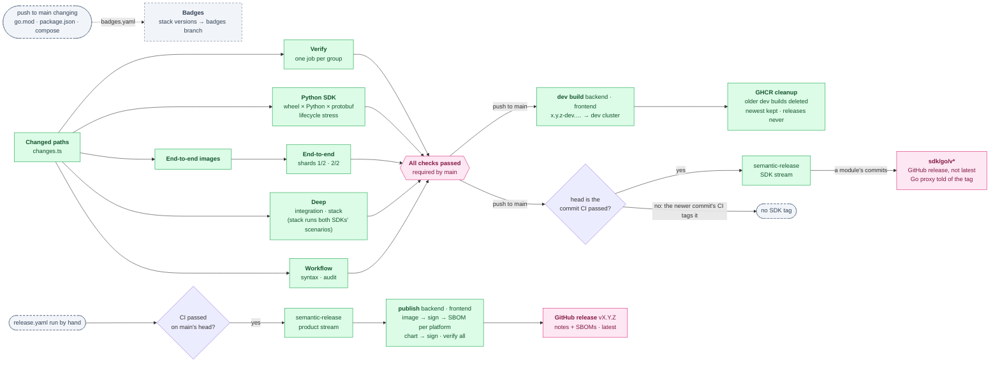

# How changes land

`main` is the only long-lived branch. Changes reach it through pull requests,
with [Conventional Commits](https://www.conventionalcommits.org/en/v1.0.0/).
The commit type is what decides the next release, so a subject that does not
follow the format releases nothing.

[`ci.yaml`](../.github/workflows/ci.yaml) runs the groups of `verify-all` a
change can reach — `verify-backend`, `verify-sdk`, `verify-frontend` and
`verify-repo`, one job each — and audits the workflows
with actionlint and zizmor. A change the `sdk` group reaches also installs the
Python SDK's wheel beside each protobuf major and Python it supports, every
cell of [`sdk/python/compat.json`](../sdk/python/compat.json) side by side in
one job (`verify-py-sdk-compat` locally), and runs the client lifecycle stress in
`sdk/python/tests/test_lifecycle.py` at a count high enough to catch an
intermittent abort at exit. [`.github/ci/changes.ts`](../.github/ci/changes.ts)
decides which groups a set of paths reaches; a console-only change does not
run the backend's tests. Run by hand, it runs every group. A final `All checks
passed` job is the one check branch protection requires, so a group that was
skipped does not block a merge and a group that failed does.
[`codeql.yaml`](../.github/workflows/codeql.yaml) runs CodeQL on the Go,
TypeScript, Python and workflow code.

A change that touches only documentation (Markdown, `docs/`, images, the
licence files) runs no verify group and no CodeQL analysis, and does not
dispatch a release run. Its commits count towards the next release.

Any other green push to `main` dispatches
[`release.yaml`](../.github/workflows/release.yaml), which publishes a **dev
build** of that commit — both images and both charts at
`<next patch>-dev.<time>.g<sha>` — and cuts `sdk/go/v*` when a commit touched
the SDK. The dev cluster follows the dev builds, so it runs every change as it
lands. Each dev publish then deletes the older dev builds of that component's
image and chart from GHCR, keeping the newest few, so a build the cluster is
still deploying or running is not pulled out from under it
([`ghcr-cleanup.ts`](../.github/ci/ghcr-cleanup.ts)); releases
are never deleted.

The product is **released by hand**, as a train ([ADR-0034](adr/0034-the-product-releases-as-a-train.md)):
running `release.yaml` from the Actions tab, or `gh workflow run release.yaml`,
tags main's head once CI passed on it. semantic-release computes the tag from
every commit since the last release, so however many breaking changes the train
carries make one major; the images and charts are pushed at that version, and
the GitHub release with generated notes is created once all of them are. The
`api/v*` baseline is cut by hand. See [releasing.md](releasing.md).

`ci.yaml` pushes no image and deploys nothing. Images and charts are published
only by `release.yaml`: a dev build for every commit CI passed on `main`, and a
release for a tag. Its End-to-end images job builds
both images once, and its two End-to-end jobs run `verify-e2e:run` —
Playwright against a stack booted from those images — each on half the suite
(`PALADIN_E2E_SHARD`), when the change reaches the console or the backend, and its two Deep jobs run the halves of
`verify-deep` side by side — `verify-deep:integration`, the Postgres-backed
suites, and `verify-deep:stack`, the stack gate, which also drives both
SDKs through the scenarios in `sdk/testdata/scenarios.json` — when the
change reaches the backend or an SDK. The `All checks passed` check that `main` requires waits for all of them;
[task.md](task.md#working-on-the-code) lists them for running locally.

Every check `ci.yaml` runs has a local task. The verify groups, `verify-e2e` and
`verify-deep` are those tasks; its Workflow syntax and Workflow audit jobs
(actionlint, zizmor) are `task -t Taskfile.dev.yaml verify:workflows`, at the
versions `ci.yaml` pins. The Python SDK lifecycle job is `py-sdk:test` with
`PALADIN_LIFECYCLE_RUNS` raised; the test suite runs a few of the same cycles
every time. Three things have no local form, by their nature:
CodeQL ([`codeql.yaml`](../.github/workflows/codeql.yaml)), which is GitHub's
own analysis and reports to the repository's code-scanning alerts; the
publishing workflow, [`release.yaml`](../.github/workflows/release.yaml), which
pushes images, charts and the release tags and runs only from `main`; and
[`badges.yaml`](../.github/workflows/badges.yaml), which pushes the stack
versions the README's badges read to the `badges` branch — its script,
[`badges.ts`](../.github/ci/badges.ts), is tested by `verify:ci`.
